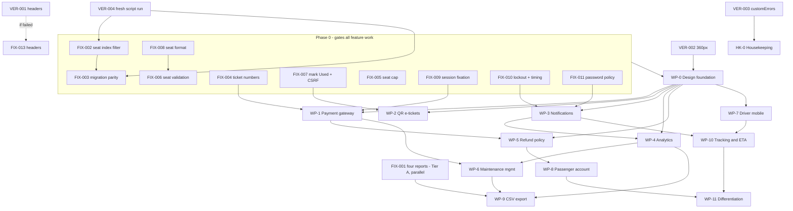

# BusNova — Remediation and Enhancement Roadmap

**Date:** 2026-09-21
**Source of truth for defects:** [AUDIT_FINDINGS.md](AUDIT_FINDINGS.md)
**Status:** Stage 2 planning complete. No fix code has been written.

---

## 1. Audit summary

| Severity | Confirmed | Suspected | Total | Disposition |
|---|---|---|---|---|
| Critical | 2 | 0 | 2 | Phase 0 — FIX-001, FIX-002 |
| High | 11 | 1 | 12 | Phase 0 — FIX-003 … FIX-011, FIX-015; AUD-050 → WP-0a; the Suspected one becomes VER-001 |
| Medium | 15 | 2 | 17 | Folded into work packages as extra acceptance criteria, except AUD-048 → FIX-014 **(done)**; the 2 Suspected become VER-002, VER-003 |
| Low | 9 | 1 | 10 | Housekeeping items HK-0 … HK-3; the Suspected one becomes VER-004 |
| **Total** | **37** | **4** | **41** | |

**13 fix items** in Phase 0 (**FIX-014 complete**), **4 verification tasks** in Stage 0, **16 Medium findings** absorbed into work packages, **17 Low findings** across four housekeeping items.

### WP-0a — Sidebar navigation — **COMPLETE** (2026-09-22, commit `8ad99f4`)

Delivered against every acceptance criterion in the brief, verified under CDP device emulation rather than by eye. Scope decision: the shell applies to the 14 operational screens only; public pages keep the marketing navbar and footer. Two defects found and fixed during the work (a 31px top-bar overflow at 360px, and an orphaned `--%>` leaking raw markup into every dashboard page). AUD-050 resolved; AUD-051 remains open and belongs to WP-0's data-table component. Screenshots for 1920/1280-expanded/1280-collapsed/768/360-closed/360-drawer are held outside the repo pending a decision on where they should live.

Original scope below, retained for reference.

Converts the top navbar into a collapsible left sidebar. Tier B on `Site.Master`, Tier A for new CSS and JS. Role visibility rules are unchanged — only their rendering location moves.

**Absorbs AUD-050, AUD-026, AUD-027 in part.** Added acceptance criteria:
- `Site.Master`'s `<head>` gains `<meta name="viewport" content="width=device-width, initial-scale=1" />`. Without it no media query below ~980px has ever fired on a real phone, so the off-canvas drawer at 768px cannot work and the existing 480/560px breakpoints have never been active. *(AUD-050 — this is a prerequisite for every responsive acceptance criterion in this package.)*
- Manager nav groups into **Fleet** (Register Bus, Create Route, Assign Route), **Ticketing** (Issue Ticket) and **Admin** (Manage Users), with Dashboard standalone. Driver, MaintenanceStaff and Passenger navs stay flat at 4, 2 and 3 items.
- Signed in as each of the four seeded roles, the set of reachable nav destinations matches the pre-change build exactly.
- Renaming any nav class also updates `Site.master.cs:81` (which returns the literal `"nav-link active"`) and the print rule at `Styles/Ticket.css:161` (which hides `.custom-navbar`). These are the only two couplings outside `Site.Master`; grep evidence goes in the change manifest.

### Decisions taken (2026-09-21, post-review)

- **§2.1 — FIX-001 runs in parallel**, not as a gate. Confirmed.
- **Sequencing exception:** FIX-014 (encoding) ships first, then **WP-0a (sidebar navigation)** runs as an explicitly approved exception to the Phase 0 gate in §3.2. WP-0a is Tier B, touches only `Site.Master` and CSS/JS, and is a prerequisite shape for the wider WP-0 design foundation. The gate otherwise stands.
- **AUD-049 scope:** findings list and a separate Tier C proposal only. No schema change inside FIX-014.
- **BOM policy:** `<globalization>` plus BOMs on affected compiled files only, not a 103-file sweep.

---

## 2. Open decisions — read before approving

Three points where I think the brief's own rules produce an outcome worth a second look. I have followed the rules as written in each case; these are flagged so you can override rather than discover them later.

**2.1 — FIX-001 (build the four reports) blocks all feature work.**
AUD-001 is Critical, so by §3.1 it lands in Phase 0, and by §3.2 nothing in Phases 1–3 may start until Phase 0 completes. That means four report pages gate the payment gateway, QR tickets and everything after. FIX-001 is **Tier A** (entirely new files) and touches no existing behaviour, so the usual reason for blocking — regression risk — does not apply here. **Recommendation:** let FIX-001 run in parallel with the rest of Phase 0 and with WP-0, rather than treating it as a gate. It is marked accordingly below; say the word if you want it strictly sequential.

**2.2 — AUD-014 is classified Medium but behaves like a defect, not a gap.**
A bus or driver can be double-booked across a midnight boundary because both conflict queries filter on a single `AssignmentDate`. That is a wrong answer from a correctness check, which is the definition of High in your own scale, not a missing feature. As a Medium it folds into WP-4 and is not fixed until Phase 1. **Recommendation:** promote it to **FIX-012** in Phase 0. It is listed in both places below — as a WP-4 acceptance criterion and as a bracketed Phase 0 row — so you can pick one and delete the other.

**2.3 — FIX-007 changes a read-only handler into a state-changing one.**
`IssueTicket.btnValidate_Click` currently has no CSRF check, and correctly so — it only reads. The moment it marks a ticket `Used` it becomes state-changing and **must** gain `AntiForgery.IsValid`, or FIX-007 opens the one CSRF hole the audit confirmed does not exist. This is written into FIX-007's acceptance test rather than left to be remembered.

---

## 3. Stage 0 — Verification tasks

Four Suspected findings, each settled by one runtime action. Do these first: VER-001 decides whether a High-severity fix is needed at all, and VER-004 decides whether FIX-002 and FIX-003 are working against a sound baseline.

- [ ] **VER-001** — *(AUD-012, High)* Confirm the three security headers are actually emitted and `X-Powered-By` is actually absent. **Action:** run the site and `curl -I http://localhost:<port>/Home.aspx`; check for `X-Content-Type-Options`, `X-Frame-Options`, `Referrer-Policy`, and the absence of `X-Powered-By`. **If they are missing, this becomes FIX-013 in Phase 0.**
- [ ] **VER-002** — *(AUD-027, Medium)* Confirm whether the seat map overflows at 360px. **Action:** open `BookTrip.aspx` in a browser at 360px width and check for horizontal page scroll on the seat grid. **Feeds WP-0 and WP-7.**
- [ ] **VER-003** — *(AUD-029, Medium)* Confirm whether a 404 returns HTTP 500 with the wrong message. **Action:** request `/NoSuchPage.aspx` and check the response status code and the heading rendered. **If confirmed, fold into HK-0 as a `Web.config` correction.**
- [ ] **VER-004** — *(AUD-030, Medium)* Confirm the creation script runs clean on a fresh instance. **Action:** run `App_Data/BusNova_Database_Script.sql` against a scratch database on the SQL Express instance and confirm it completes with no error and prints its success block. **Blocks FIX-002 and FIX-003, which both need a known-good baseline to diff against.**

---

## 4. Phase 0 — Critical and High fixes

One commit per item. Each commit updates the corresponding finding in `AUDIT_FINDINGS.md` to **Resolved**. Full test suite runs green before every commit.

| FIX-ID | Source | Defect | Files | Tier | Acceptance test | Regression risk |
|---|---|---|---|---|---|---|
| **FIX-001** | AUD-001 | None of Project 6's four required reports exists. | New `Reports/RouteCompletion.aspx`, `Reports/FuelEfficiency.aspx`, `Reports/DriverPerformance.aspx`, `Reports/MaintenanceDue.aspx` + `.cs`; new `Services/ReportingService.cs`; `Site.Master` (nav, Tier B) | A (+B for nav) | All four pages render for a Manager against seeded data; each figure matches a hand-written SQL query run independently; each page calls `RequireRole(Manager)` first; a Driver and a Passenger both get `Error.aspx?code=403`. | **Low** — purely additive; only the `Site.Master` nav edit touches existing markup. |
| **FIX-002** | AUD-002 | `UQ_Ticket_AssignmentSeat` is unfiltered in deployed databases, so a cancelled seat can never be resold. | New `App_Data/Migrations/005_TicketSeatIndexFilter.sql` | **C** | On a database with a cancelled ticket for seat S on trip T, booking seat S on trip T succeeds; `sys.indexes` reports `has_filter = 1` with filter `([TicketStatus]<>'Cancelled')`; the migration is idempotent and survives a second run. | **Medium** — index drop/recreate. Will fail if two *non-cancelled* rows already share `(AssignmentID, SeatNumber)`; the migration must detect and report that case rather than half-apply. |
| **FIX-003** | AUD-003 | No migration path brings an existing database up to the current script; script revision 12 has no migration. | `App_Data/Migrations/005_*.sql`, new `App_Data/Migrations/README.md`, `README.md`, `SYSTEM_OVERVIEW.md` | B | A database built from the full script and a database built from an older script plus migrations 002–005 have identical `sys.indexes` and `sys.check_constraints` sets, proven by a diff query. | **Low** — documentation and a new script only. |
| **FIX-004** | AUD-004 | `BN-######` derives from `MAX(TicketID)+1`, which is not the identity assigned; the two have already diverged in live data. | `Services/TicketService.cs:311-317`, `:452-458`; possibly new `App_Data/Migrations/00N_TicketNumberSequence.sql` | **C** | After forcing an identity gap with `DBCC CHECKIDENT`, newly issued numbers remain contiguous and unique; concurrent inserts produce no duplicate `TicketNumber`; **existing ticket numbers are not rewritten**. | **Medium** — this is the only ticket-creation path in the system. Passengers holding printed `BN-` numbers must keep them valid. |
| **FIX-005** | AUD-005 | A tampered `hfSelectedSeats` with 6+ seats throws `IndexOutOfRangeException` and lands the passenger on the error page. | `BookTrip.aspx.cs:158-174` | **C** | A POST carrying six seats shows "You can book at most 5 seats" and writes **nothing** to `App_Data/Logs`; 1–5 seats continue to work unchanged. | **Low** — adds a guard ahead of an existing loop. |
| **FIX-006** | AUD-006 | `CreateBooking` validates neither seat length nor seat range; an over-length seat raises an unhandled truncation `SqlException`. | `Services/TicketService.cs:382-396` | **C** | A seat longer than 5 characters is rejected with a friendly message and no `SqlException`; a seat outside `1..SeatingCapacity` is rejected; valid seats unaffected; `PurchaseTicket` behaviour byte-identical. | **Medium** — range validation will reject legacy `12A`-format seats. **Depends on FIX-008**, or must accept both formats during the transition. |
| **FIX-007** | AUD-007 | No code ever sets `TicketStatus = 'Used'`; a ticket validates as `Valid` forever. | New `TicketService.MarkTicketUsed`; `IssueTicket.aspx.cs:301-320`; `IssueTicket.aspx` | **C** | Validating a `Valid` ticket transitions it to `Used` and writes an audit row; a second validation reports "already used"; a `Cancelled` ticket cannot be marked `Used`; **`btnValidate_Click` now calls `AntiForgery.IsValid` before writing** (see §2.3). | **Medium** — converts a read-only handler into a state-changing one. Missing the CSRF check here would open the only CSRF hole in the application. |
| **FIX-008** | AUD-008 | Seat identifiers exist in two mutually blind formats; the seat map will resell an occupied seat on a freshly seeded database. | `App_Data/BusNova_Database_Script.sql:640-644`; new `App_Data/Migrations/006_SeatNumberNormalisation.sql`; `Helpers/SeatMapRenderer.cs` | **C** | Every `Ticket.SeatNumber` matches `^[0-9]{1,3}$` after migration; on a freshly seeded database the seat map marks every occupied seat as taken; no two non-cancelled tickets share a normalised seat on one trip. | **High** — rewrites existing data. Needs an agreed mapping rule for `12A` → *n*, a pre-migration snapshot, and documented rollback. |
| **FIX-009** | AUD-009 | The session id is never regenerated on sign-in, leaving the app open to session fixation. | `Security/SessionHelper.cs:32-42` | **C** | The `ASP.NET_SessionId` cookie value after a successful sign-in differs from its value before; the CSRF token is reissued with it; the user still lands on the correct dashboard and `returnUrl` still works. | **High** — this is the authentication path. A mistake signs everyone out or breaks `returnUrl`. Web Forms makes session-id reissue fiddly; expect a written proposal before any edit. |
| **FIX-010** | AUD-010 *(absorbs AUD-021)* | No rate limiting or lockout on sign-in; failed attempts are logged but never read. Timing also leaks which addresses exist. | `Services/AuthService.cs:38-55, 74, 120`; new `Security/LoginThrottle.cs`; possibly new migration for an attempts table | **C** | N failed attempts inside the window cause further attempts to be refused **even when the password is correct**; the lockout expires; a success resets the counter; the lockout is audited. **AUD-021:** an unknown address performs a dummy PBKDF2 verification so its response time is indistinguishable from a known address. | **Medium** — a too-tight threshold locks out demo accounts mid-demonstration. Threshold and window must be `appSettings`-configurable and generous by default. |
| **FIX-011** | AUD-011 | Three different password rules; the weakest one protects Manager accounts. | `Services/AdminService.cs:93-94`; `SetPassword.aspx:36`; `SetPassword.aspx.cs:52-73`; `Security/PasswordPolicy.cs` | **C** | All three creation paths reject a policy-failing password with the same message; **existing accounts continue to sign in unchanged** (verification is not touched); new unit tests cover each of the three paths. | **Low** — creation-time only. Verification, and therefore every seeded demo login, is untouched. |
| *[**FIX-012**]* | *[AUD-014]* | *[Conflict detection filters on a single `AssignmentDate`, so a trip crossing midnight is invisible and a bus or driver can be double-booked.]* | *[`Services/AssignmentService.cs:163, 190`]* | *[**C**]* | *[A trip 23:00–01:30 on day 1 blocks an overlapping assignment at 00:30 on day 2 for the same bus and the same driver; same-day overlaps still behave as before.]* | *[**Medium** — rewriting the overlap predicate risks over-blocking legitimate back-to-back trips.]* |
| *[**FIX-013**]* | *[AUD-012]* | *[Only if VER-001 shows the security headers are not emitted.]* | *[`Web.config:74-83`]* | *[B]* | *[`curl -I` shows all three headers present and `X-Powered-By` absent.]* | *[Low]* |
| **FIX-014** | AUD-048 | No `<globalization>` block anywhere, so BOM-less source is decoded as cp1252 and UTF-8 literals render as `â€"`. `Site.Master` emits no charset meta tag. | `Web.config`; `Web.Release.config` (verify only); `Site.Master`; `AssignRoute.aspx`; `MyTickets.aspx`; `README.md` | B | `Web.config` carries `requestEncoding`/`responseEncoding`/`fileEncoding` = `utf-8`; `<meta charset="utf-8" />` is the first element in `<head>`; the three affected literals render with a real em dash at runtime; no `â€`/`é`/`Â` anywhere in source; build and all 33 tests still pass. | **Low** — configuration and two markup files. No service, code-behind or SQL change. |
| **FIX-015** | AUD-049 | Zero `nvarchar` columns and a cp1252 collation, so any non-cp1252 character in user-entered text is silently replaced with `?` on insert. | New `App_Data/Migrations/00N_UnicodeColumns.sql`; `App_Data/BusNova_Database_Script.sql` **(new tables only — existing script is not edited)** | **C** | A passenger named `Ānish Mokoena-Wéllington` round-trips unchanged through create → read → report export → database query; all ~22 user-text columns report `nvarchar`; indexes and constraints on converted columns survive; rollback script restores the prior types. | **High** — alters existing column types on populated tables. Needs a column-by-column inventory, index/constraint drop-and-recreate ordering, a snapshot, and a written rollback. **Raised as its own proposal; not executed as part of FIX-014.** |

Bracketed rows are conditional — FIX-012 on your decision in §2.2, FIX-013 on the outcome of VER-001.

**Gate:** no work package in Phases 1–3 begins until FIX-002 through FIX-011 are complete and verified, with FIX-001 exempted per §2.1.

---

## 5. Phase 1 — Production essentials

### WP-0 Design foundation
*Runs after Phase 0 fixes, before all other Phase 1 work.*

Tokens, app shell, page-header/card/table/form patterns, accessibility baseline, documented anti-pattern list.

**Absorbs AUD-024, AUD-025, AUD-026, AUD-027.** Added acceptance criteria:
- Zero `style="…"` attributes remain in any `.aspx` or `.Master` file, and no HTML with an inline style is built in C# — the fragment at `Dashboard.aspx.cs:209` moves to a CSS class. *(AUD-024)*
- The three `confirm()` dialogs at `ManageUsers.aspx:158`, `ManageUsers.aspx:201` and `MyTickets.aspx:74` are replaced by an in-page confirmation pattern that is styleable, keyboard-reachable and screen-reader-announced. *(AUD-025)*
- `Styles/SeatMap.css` and `Styles/style.css` gain breakpoints consistent with the rest of the system, and the design system defines 360px as the lowest supported width. *(AUD-026)*
- The overflow found by VER-002 is fixed and re-checked at 360 / 768 / 1280 / 1920. *(AUD-027)*
- `Dashboard.StatusCss` distinguishes `UnderMaintenance` from `Retired`. *(AUD-038, pulled forward from HK-3 because the token set is defined here.)*

### WP-1 Payment gateway — **COMPLETE** (2026-09-22)

Delivered: migration 009 (`PaymentTransaction`, `PaymentEvent`, `PaymentRefund`, two `NO CACHE` sequences),
`Services/PaymentService.cs`, `Helpers/AppClock.cs`, and a rewired `PaymentSimulation.aspx`. 26 new unit tests
(suite 57 → 83).

Order of operations is the substance of this package: **authorise, then write the seats, then capture.** A
decline never reaches `CreateBooking`, so it cannot leave seats held for a payment that did not happen; and a
booking that fails after authorisation voids the authorisation, so money is never captured for seats the
passenger did not get. Both halves were proven at runtime, not reasoned about — see the evidence below.

Runtime evidence, all against the live database:
- **End-to-end booking completes** (AUD-020). `BNB-000001`, audit row 1166, ticket with non-null `BookingID`,
  payment `BNPAY-000001` Captured and linked. This path had never completed before.
- **Declined card** (`…0002`) → status `Declined`, no booking row, no ticket. **Gateway failure** (`…0119`)
  → status `Failed`, distinct from a decline because the passenger did nothing wrong.
- **Seat stolen mid-payment** → authorisation `Voided`, no booking, message "No charge was made", and the
  event log carries the whole sequence Created → AuthorisationRequested → Authorised → Voided.
- **Double submit** → exactly one booking, one ticket, one captured payment. Caught by the cleared-draft
  check; the idempotency key is the second line of defence behind it, not the one that fired here.
- **Two concurrent bookings** both completed, with interleaved payment references (AUD-018).
- **No card data stored**: `CardLast4` is `CHAR(4)`, there is no CVV column, and a search for the test PAN
  across `PaymentTransaction` and `PaymentEvent.Detail` returns zero rows.
- **AUD-045**: the passenger-facing "Simulate a declined payment" checkbox is gone from the served HTML;
  forcing a decline via `BusNova:PaymentSandboxForceOutcome` was verified and the setting then removed.

Deliberately **not** done here: AUD-053. See the header of `009_PaymentGateway.sql` for why half-migrating the
timestamps would have been worse than leaving them consistent.

`PaymentTransaction`, `PaymentRefund`, `PaymentEvent`; deterministic sandbox; server-side verification; no raw card data stored.

**Absorbs AUD-018, AUD-020.** Added acceptance criteria:
- An end-to-end passenger booking completes and is proven by data: a `dbo.Booking` row exists, a `BookingCreated` audit row exists, and its tickets carry a non-null `BookingID`. This is the first time that path will have completed (see AUD-020) and it is the single most important acceptance test in the roadmap. *(AUD-020)*
- Ticket and booking number allocation no longer serialises every sale behind a `TABLOCKX` table lock, and the lock is not retaken once per traveller inside the booking loop. Two concurrent bookings on the same trip both complete. *(AUD-018 — builds directly on FIX-004.)*
- The "Simulate a declined payment" checkbox is removed from the passenger-facing page and replaced by a sandbox-only mechanism. *(AUD-045, pulled forward from HK-1.)*

### WP-2 QR e-tickets — **COMPLETE** (2026-09-22)

Delivered: `Security/TicketToken.cs`, `Services/TicketValidationService.cs`, `ValidateTicket.aspx`, migration 010
(`TicketValidationLog`), and a QR code that now carries a token instead of a ticket number. 15 new unit tests
(suite 83 → 98). Recorded as AUD-055, which this package also closes.

**The token.** `MachineKey.Protect` — encrypt *and* authenticate, using the key ASP.NET already manages. No new
secret, none in source control, no hand-rolled cryptography. The payload is a version, the ticket’s integer id and
an issue time. No passenger name, email or seat goes in, so none can come out, and being encrypted nothing is
readable regardless. Altering one character makes it fail to open rather than decode to something else.

Deliberately **no** explicit `<machineKey>`: ASP.NET’s auto-generated key is stable across restarts on one machine,
which is this deployment, and pinning a key in Web.config would put a signing secret in git to solve a problem that
does not exist here. The consequence is stated in `TicketToken`’s summary rather than left to be discovered — tokens
are machine-bound, and on a move or a farm they fail *closed*, with the manual fallback carrying passengers
meanwhile.

**The door screen.** `ValidateTicket.aspx`, open to Driver and Manager. Driver because the driver is who stands at
the door; Manager because migration 003 folded the conductor role into Manager. A trip selector scopes validation so
that a valid ticket for a *different* departure is refused as `WrongTrip` — a different conversation from "your
ticket is no good" — rather than boarded onto the wrong bus.

**The manual fallback** is not a concession, it is the point. Scanners fail and screens crack; a validation screen
with no manual path just moves the argument to the roadside.

**Every attempt is logged**, refusals included. A log of only successful boardings cannot answer the questions a
depot actually asks. The raw token is never stored — it is a bearer credential, and a table of working tokens would
be worth stealing — so `TokenFingerprint` holds a truncated SHA-256 instead: enough to tell one bad token tried
nine times from nine different bad tokens.

The `Used` transition itself is still `TicketService.MarkTicketUsed` from FIX-007; this package calls it rather than
reimplementing the atomic check.

Signed opaque token carrying no PII, `TicketValidationLog`, conductor/driver validation page, manual-entry fallback.

**Depends on FIX-007**, which introduces the `Used` transition this package's validation flow builds on. Added acceptance criterion:
- The QR payload is a signed opaque token, not the bare ticket number. The current implementation encodes `TicketNumber` directly, client-side, with no signature (`Scripts/ticket-confirmation.js`, `TicketConfirmation.aspx:85`) — a forged QR is currently trivial.

### WP-3 Notifications — **COMPLETE** (2026-09-22)

Delivered: migration 011 (`Notification`), `Services/NotificationService.cs` with `INotificationSender`,
`Notifications.aspx` for the operator, and AUD-022's transport fix. 9 new unit tests.

**Durable queue, not inline send.** A passenger completing a booking should not wait on a mail server, and a send
that fails during checkout should not vanish. Retry uses exponential backoff capped at 30 minutes; after
`MaxAttempts` a message is dead-lettered rather than retried forever, because a message that has failed five times
is misaddressed and needs a person, not a sixth attempt. Dead-lettered rows are kept — "we never told the
passenger" is exactly what someone needs to establish later.

**There is no mail server, and the code says so.** `QueueOnlySender` succeeds honestly: delivery is the durable
row, and an operator can read it. It is not a stub that reports success while discarding the message — that is
precisely the bug this package removed, where `TicketConfirmation` told a passenger "a copy was emailed to you"
and emailed nothing. The wording now matches what happened.

**Dispatch is a button, not a timer**, because a Web Forms site has no host process that outlives a request. That
is an honest limitation, and it is why the queue is durable: the work waits rather than being lost. A real
scheduler later calls the same `DispatchDue`.

**AUD-022** — the one-time token moved from the query string to the URL fragment, which browsers never send to any
server. Verified end to end: the server saw only `?pid=1005`, the token arrived in the POST body, the password was
set and the token consumed. A link pasted without the part after the `#` gets a specific message.

`Notification` table with retry/backoff/dead-letter; `INotificationSender`; DB-queued by default, SMTP optional.

**Absorbs AUD-022.** Added acceptance criterion:
- The walk-up password-setup link is delivered through the notification channel rather than displayed on screen and passed in a URL query string, or — where it must still be handed over in person — the token moves out of the query string. Tokens no longer appear in IIS logs, browser history, or `Referer` headers sent to the CDN. *(AUD-022)*
- The simulated "send to my email" action on `TicketConfirmation.aspx:73-86` becomes a real queued notification.

### WP-4 Analytics dashboard — **COMPLETE** (2026-09-22)

Delivered: `Services/AnalyticsService.cs`, migration 012 (7 foreign-key indexes + 3 covering indexes), a rebuilt
manager dashboard with revenue, occupancy and a "Needs attention" table. 4 new unit tests.

**Occupancy is defined, not assumed.** Seats sold over seats offered, summed independently and divided once — not
the mean of per-trip percentages, which would let a half-empty 12-seater weigh as much as a full 60-seater.
Cancelled tickets are excluded because they did not occupy a seat. Trips whose bus has no recorded capacity
contribute to neither side rather than contributing a zero. No seats offered gives a dash, not 0%, because "no
trips ran" and "trips ran empty" are different facts. The whole definition is in a tooltip on the page, so the
figure can be argued with rather than believed.

**AUD-039** — all three offenders now count in SQL rather than loading whole tables.
**AUD-019** — verified by re-running the audit's own detection query: zero unindexed foreign keys remain.
**AUD-014** — the overlap arithmetic was always right; the date filter was not. Candidate rows now span the day
either side, so a trip crossing midnight is visible to the check.
**AUD-013** — *not* fixed, because it cannot be fixed with an index. An overlap is a range comparison and a unique
constraint has no notion of a range. What was fixed is the claim: the code and `SYSTEM_OVERVIEW.md` said the
indexes prevented overlapping double-bookings, and they never did. The application check is now documented as the
only defence and as load-bearing.

The full metric list from the Operations brief, occupancy % per route with a worked tooltip, attention-required tables.

**Absorbs AUD-013, AUD-014, AUD-019.** Added acceptance criteria:
- The scheduling data underlying every occupancy and completion metric is free of overlapping double-bookings. The application-level overlap check is the only real defence (the filtered unique indexes constrain identical slots only, not overlaps) and must be documented as such, with `SYSTEM_OVERVIEW.md:98` corrected to match. *(AUD-013)*
- A trip crossing midnight is correctly detected as a conflict. *(AUD-014 — **delete this criterion if you promote it to FIX-012 per §2.2**.)*
- The seven unindexed foreign keys gain supporting indexes, and each dashboard query is checked for a scan that the new indexes should have removed. *(AUD-019)*
- Dashboard counters are computed in SQL rather than by loading whole tables into memory. *(AUD-039, pulled forward from HK-2 — the analytics rewrite touches exactly these code paths.)*

### WP-5 Cancellation and refund policy — **COMPLETE** (2026-09-22)

Delivered: `Services/RefundPolicyService.cs`, migration 013 (reason, tier, amount, who, when on `dbo.Ticket`),
refund movements into `dbo.PaymentRefund`, and an honest cancellation message. 20 new unit tests.

**The tiers**, measured from the departure MOMENT and all configurable: full beyond 24h, 50% between 2h and 24h,
none inside 2h, and no cancellation at all after departure. Operator-side cancellations refund in full regardless
of timing — charging a passenger a late-cancellation penalty for the operator's own decision is indefensible.

**"No refund but still cancellable" is deliberate.** Refusing the cancellation would keep the seat blocked for a
passenger who is definitely not coming: the operator loses a resaleable seat and the passenger gains nothing.

**AUD-015** — fixed in both halves, the service and the screen. Verified: a trip moved to today 07:30 offered zero
Cancel buttons at 21:39, where the date-only rule would have offered one all day.
**AUD-023** — reason code, tier, amount, who and when are stored, and the money movement is a `PaymentRefund` row
with a `PaymentEvent`. Verified at runtime across both tiers: Full 185.00 and Partial 92.50, with the payment
moving Captured → Refunded.
**AUD-028** — the refund policy is tested, and so is the previously untested validation in `CreateBooking` and
`CreateEmployee`, by calling the real methods rather than reimplementing their rules.

Configurable cut-off / partial / no-refund tiers, admin cancellation, automatic seat release, reason codes, `RefundPolicyService` with unit tests.

**Absorbs AUD-015, AUD-023, AUD-028.** Added acceptance criteria:
- Cancellation respects the trip's departure *time*, not merely its date. A ticket for a trip that departed at 07:30 cannot be cancelled at 14:00 the same day. *(AUD-015)*
- Refunds follow a configurable policy with reason codes and an audit trail of who cancelled and when, replacing the unconditional flip to `Refunded` at `Services/TicketService.cs:525-531`. *(AUD-023)*
- `RefundPolicyService` is unit-tested, **and** the existing database-free validation in `TicketService.CreateBooking` (traveller cap, duplicate names, duplicate seats) and `AdminService.CreateEmployee` (role-specific required fields) gains test coverage. The suite must execute at least some `Services/` code, which today it does not. *(AUD-028)*

---

## 6. Phase 2 — Operational efficiency

### WP-6 Maintenance management — **COMPLETE** (2026-09-22)

Delivered: migration 014 (labour and release-approval columns, `MaintenancePart`, `BusServiceSchedule`,
`TripInspection`), `MaintenanceScheduleService`, `MaintenancePartsService`, transaction support in `Db`, and
AUD-017. 14 new unit tests.

**AUD-017** — all three multi-statement writes are now single transactions. `Db.InTransaction` takes the
connection and transaction explicitly rather than hiding them in ambient state: more typing at the call site, and
you can see what is inside the transaction by reading the method. `LogService`’s "is another critical fault still
open" check moved inside the transaction as well — outside it, two staff closing the last two critical faults at
the same moment could both see zero others open and both put the bus back on the road.

**LogService’s contract was contradictory** and is fixed: it returned `Fail` in the case where the work had
saved but the bus had to stay grounded. The page carried a comment explaining the contradiction rather than the
service not having it. It now always succeeds if the work saved, and says in `Message` whether the bus went back
on the road.

**Preventive schedules** express "every 15 000 km or 6 months, whichever comes first", which the single
`Bus.NextServiceDueDate` column cannot. `Due()` is pure — odometer and clock are arguments — and says which limit
brought the work due, because "due in 400 km" and "due in 3 days" lead to different decisions today. A schedule
never serviced is reported as due rather than fine: no baseline means nobody knows, and "fine for another
15 000 km" would be a guess presented as a measurement.

**Parts are rows, not free text.** `PartsUsed` stays for existing records — inventing structured rows from
"brake pads + fluid" would be making data up — but new work itemises name, number, supplier, quantity and unit
cost, with the line total computed in the database so it cannot disagree with its inputs.

**Scoped out, deliberately:** attachments and fault photos, which need a file store and an upload policy this
brief does not settle. Release approval has its columns and is not yet enforced; turning it on means the person
who does the work can no longer release the bus, which is an operational decision, not a code change.

Odometer, inspections, preventive schedules (km or months), parts and suppliers, labour, attachments, history, overdue alerts, release approval.

**Absorbs AUD-017.** Added acceptance criterion:
- `LogService`'s multi-statement write becomes a single transaction. A forced failure partway through leaves no state in which the maintenance record is closed while the bus row still reads `UnderMaintenance`. Same for `LogFuel` and `ReportIssue`. *(AUD-017 — the fuel half is shared with WP-7.)*

### WP-7 Driver mobile workspace — **COMPLETE** (2026-09-22)

Delivered: `DriverWorkspace.aspx` (+ its own stylesheet), `DriverService`, `TripInspection`, and AUD-016.

**360px first**, and verified as such rather than assumed: measured under CDP device emulation at a true 360px
viewport — `innerWidth` 360, `scrollWidth` 360, **zero** horizontal overflow, no overflowing elements, primary
buttons 52px tall, checklist rows 48px. This is not the desktop schedule squeezed down; it is a single column of
large targets, the trip is chosen for the driver, and the destructive action is the only red thing on the page.

**AUD-016** — `StartTrip` was a single UPDATE with no gating whatsoever: a driver could start a trip scheduled
for next month, on a bus that had been grounded since the assignment was made. It now checks the departure moment
and the bus status, and returns a reason rather than a bool. Each branch verified at runtime; see AUD-016 in the
findings for the exact messages.

**The boarded count is taken from the tickets**, not typed by the driver. It is already recorded by the
validation screen, so reading it from there means the trip’s passenger figure agrees with its tickets instead of
being a second, independent guess.

**An unticked inspection item means NOT CHECKED, not a fault.** Conflating the two would turn every rushed
inspection into a maintenance backlog and bury the real faults. The counts are stored so the gap is visible
without pretending to know what it means.

**Emergency is deliberately blunt**: one button, one action, and the action is the safe one. Grounding a bus that
turns out to be fine costs a morning; not grounding one that is not fine costs considerably more. The
confirmation dialog stops an accidental press; once pressed it does not ask again.

**Scoped out, deliberately:** the offline queue, which needs a service worker and a conflict-resolution policy for
work submitted from a tunnel, and fault photos (see WP-6). Both are real features, not oversights, and neither is
a small addition to this page.

360px-first; manifest, checklists, pre/post-trip inspection, fuel and odometer, fault photos, emergency button, delay report, boarding count, offline queue.

**Absorbs AUD-016.** Added acceptance criteria:
- Start-trip is gated and shows a *specific* failing reason. A trip scheduled for a future date cannot be started, and a trip whose bus is no longer `Active` cannot be started — each with its own message rather than the current generic failure. *(AUD-016)*
- `LogFuel`'s insert-plus-odometer-update is transactional. *(AUD-017, shared with WP-6.)*
- Verified at 360px as the primary target, per the WP-0 baseline.

### WP-8 Passenger search, account and manifests — **COMPLETE** (2026-09-23)

Delivered: booking history and reference lookup on `MyTickets.aspx`, and `Manifest.aspx` — a printable passenger
list. Closes AUD-035 and half of AUD-040.

**Origin/destination/date search already existed** on `BookTrip.aspx` (`TicketService.GetBookableTrips`), so this
package did not rebuild it. Saying so matters: the acceptance criterion was met by code that was already there,
and re-implementing it would have been motion rather than progress.

**Tickets and bookings are two lists, not one.** A counter sale produces a ticket with no booking, so a merged
view would have to explain why half its rows have no reference.

**The reference lookup re-checks ownership.** Booking references are sequential, so without that check a passenger
could read someone else’s booking by guessing the next number. An unknown reference and someone else’s give the
identical message, so a guess cannot tell them apart. Verified.

**The manifest is a document, not a screen.** It exists for the case where the technology has failed — scanner
dead, phone flat, network gone — so it is a sheet of paper with a box to tick beside each name, and most of the
work is in the print stylesheet: the application chrome is hidden, the shell’s sidebar offset is undone, it prints
black on white, and the column headings repeat on every page (which works because `GridViewHelpers` puts them in a
real `thead`). Seats sort numerically, because a conductor reads the list top to bottom and seat 10 before seat 2
is worse than useless.

A driver may print only their own trip’s manifest; a manager may print any. Verified, including that a passenger
is refused the page entirely.

**Not built:** waitlists and loyalty, which the roadmap lists under WP-11; return-trip booking and booking
modification, which need a change-of-seat flow and a re-pricing rule that WP-5’s refund tiers do not cover.

Origin/destination/date search, filters, return-trip booking, modification, waitlist; profile, multiple travellers, accessibility, receipts, favourites, loyalty, feedback; printable manifest.

**Added acceptance criterion:**
- `MyTickets.aspx` shows booking history as well as ticket history, activating `TicketService.GetBookingsForPassenger` and `GetBookingByReference`, and `SYSTEM_OVERVIEW.md:59` becomes accurate. *(AUD-035, AUD-040 in part.)*

### WP-9 CSV/Excel export — **COMPLETE** (2026-09-22)

Delivered: `Helpers/TableExport.cs`, `Services/MatrixReportsService.cs`, four new report pages, export on all nine
reports, and AUD-056. 25 new unit tests (suite 161 → 186).

**No library, because none is needed.** CSV is a text format with four escaping rules. "Excel" here is an HTML
table served with an Excel content type — the method is called `WriteExcelHtml`, not `WriteXlsx`, because it is
not one and naming it so would mislead whoever next tries to open it with a spreadsheet library.

**The BOM is not optional.** Excel on Windows reads a CSV without a byte-order mark as the system's ANSI code
page, so "Msimang" survives and "Müller" does not — the same class of defect as migration 008. Verified on the
wire: the first three bytes of every CSV are `EF BB BF`.

**Formula injection is defused.** A cell beginning `=`, `+`, `-` or `@` executes when the file opens. A free-text
fault description is attacker-adjacent and the guard costs one apostrophe.

**Money exports as a bare number** with an invariant decimal point. "R 1 234,50" imports as text, and on a machine
set to en-ZA a comma decimal separator would split one column into two.

`Response.End` is deliberately not used: it raises `ThreadAbortException`, which `Global.asax` catches and logs, so
every successful download would fill the error log. Verified — no such entries after eight exports.

**The five Sprint matrix reports** the gap analysis listed are now delivered: Ticket Sales, Driver Schedule,
Maintenance Schedule, Route List, and the Fuel Efficiency report from FIX-001. That closes AUD-001 in full.

Shared helper, UTF-8-BOM CSV, HTML-table `.xls`; every report and table gets an Export action.

**Added acceptance criteria:**
- The four reports delivered by FIX-001 each gain an Export action, as do the Sprint matrix reports delivered here.
- The Sprint system matrix reports missing per the gap analysis — **Fuel Efficiency, Driver Schedule, Maintenance Schedule, Route List, Ticket Sales** — are delivered in this package. Several already have their query written: `OperationsService.GetAllFuelLogs` is currently dead code and is exactly the fuel-efficiency source; `TicketService.GetAllTickets` currently feeds one dashboard counter and is the ticket-sales source. *(AUD-001 remainder, AUD-040.)*

---

## 7. Phase 3 — Differentiation

### WP-10 Live tracking and ETA — **COMPLETE** (2026-09-23)

Delivered: migration 015 (`TripPing`, plus origin/destination coordinates on `Route`), `TrackingService`,
`LiveMap.aspx` with Leaflet and OpenStreetMap, and a position simulator. 19 new unit tests.

**An ETA here is a range, and says why.** There is no road network in this system, so remaining distance is a
great-circle line. Real roads are longer — typically 15-45% — so the estimate is widened and presented as a
window with a stated confidence. A single confident-looking time that is twenty minutes out is worse than an
honest range, because a passenger *acts* on the first and *plans around* the second. The basis is printed on
every row.

**It refuses to answer rather than guessing.** No fix, a fix older than ten minutes, a route with no destination
coordinates, or a speed of zero with no fallback — each produces "no estimate" and the reason, not a number.

**The table is the presentation; the map is an addition.** Leaflet loads from a CDN with subresource integrity.
If it fails — offline, blocked, hash mismatch — the page still answers the question, because the server rendered
the answer. A stale fix is drawn in a different colour rather than drawn identically and annotated elsewhere.

**Retention is deliberately not implemented.** `TripPing` grows far faster than every other table combined —
roughly 150 000 rows a month for a ten-bus fleet. Choosing how long to keep position history is an operational
and arguably a privacy decision, and it belongs to whoever runs the depot.

**No GPS hardware exists in this build**, so positions come from a "Simulate positions" button and every row is
marked `Source = 'Simulated'`. A real fix can never be confused with a demonstration one.

Ping tables, Leaflet + OSM, manager map, passenger status, haversine ETA with confidence band, delay alerts routed through WP-3.

### WP-11 Differentiation — **COMPLETE** (2026-09-23)

Delivered: `Services/PricingService.cs` with documented, bounded, testable rules, and AUD-042's prerequisite
coverage. 25 new unit tests. **Found and fixed AUD-057 in the process** — see below.

**Dynamic pricing nobody can explain is indistinguishable from overcharging**, so every rule is stated, applied
in a fixed order, bounded, and returned with its reason attached for the booking screen to show. Demand first
(+15% above 80% full, -10% below 30%), then lead time (+10% within 24 hours, -10% beyond 30 days), then hard
bounds at 70% and 150% of base. A cap is what stops a bug in one rule producing a fare nobody would pay; a floor
is what stops the operator losing money on a quiet Tuesday.

**It is off by default.** Turning pricing on is a commercial decision, not a deployment side effect.

**Unknown capacity earns no discount.** Capacity of zero means nobody recorded it, and an unknown occupancy is
not a low one.

**AUD-057, which this package exists to have found.** The audit asked (AUD-042) that `StandardPrice`'s fallback
be covered *before* pricing rules were layered on it. Writing that coverage took minutes and exposed a latent
hundred-fold overcharge: `NumberStyles.Number` under `InvariantCulture` treats the comma as a thousands
separator, so `BusNova:TicketPrice = "200,00"` — the ordinary South African way to write it — parsed as
**20000**, silently. `PricingService` had the identical bug, where `10,5` would have parsed as 105 and put every
percentage out by a factor of ten. Both fixed; both covered.

**Not built:** waitlists, loyalty, and feedback triage. Each is a feature with its own schema and its own
workflow, not a rule layered on an existing one, and the roadmap lists them alongside pricing rather than
underneath it.

Waitlists, multiple boarding points, dynamic pricing with documented and testable rules, loyalty, feedback and complaint triage.

**Added acceptance criterion:**
- Dynamic pricing replaces the flat `BusNova:TicketPrice`. `TicketService.StandardPrice`'s fallback contract gains the test coverage it currently lacks before the pricing rules are layered on. *(AUD-042, pulled forward from HK-1.)*

---

## 8. Housekeeping

One item per phase. These run alongside feature work and never block it.

### HK-0 — alongside Phase 0
Documentation corrections that Phase 0 makes true, plus local hygiene.

- **AUD-031, AUD-032, AUD-033, AUD-034** — correct the four `SYSTEM_OVERVIEW.md` claims about index guarantees, reference generation and ticket validation, once FIX-002, FIX-004 and FIX-007 land.
- **AUD-036** — fix the `Error.aspx.cs:11-13` comment, which cites a `requestFiltering` rule that `Web.config` does not contain.
- **AUD-041** — replace the hard `(int)` unbox of `ViewState["PassengerId"]` at `SetPassword.aspx.cs:28-32` with a safe check that shows the existing "invalid link" panel.
- **AUD-043** — replace the hard-coded `LAPTOP-B5HU784A\SQLEXPRESS` data source with a documented placeholder.
- **AUD-044** — replace the real personal email addresses in the development `dbo.Passenger` table with test data.
- **AUD-046** — note or adjust `AntiForgery.FixedTimeEquals`'s early length return.
- **VER-003 outcome** — if confirmed, correct the `customErrors` configuration so a 404 returns 404 with the right message.

### HK-1 — alongside Phase 1
- **AUD-047** — document the demo logins properly in `README.md`, including the undocumented sixth Manager (`conductor@busnova.co.za` / `Conductor@2026`), and point at the script's header block rather than its `INSERT` statements.
- Update `README.md` and `SYSTEM_OVERVIEW.md` for every Phase 1 package as it lands.

### HK-2 — alongside Phase 2
- **AUD-040** — remove or activate the remaining dead service methods; `GetMaintenanceForBus` either feeds the WP-6 per-bus history or goes.
- Update both documents for Phase 2 packages.

### HK-3 — alongside Phase 3
- **AUD-037** — replace the Font Awesome **Pro** `fa-steering-wheel` glyph at `Helpers/SeatMapRenderer.cs:55` with one that exists in the free build the site actually loads.
- Final documentation pass; confirm every AUD finding is marked **Resolved** or explicitly **Accepted**.

*(AUD-038, AUD-039, AUD-042 and AUD-045 were pulled forward into WP-0, WP-4, WP-11 and WP-1 respectively, because each sits in code those packages rewrite anyway.)*

---

## 9. Dependency graph

Anything touching auth, session, CSRF or the payment path resolves before the package that depends on it.

**Critical paths in words:**

- **FIX-008 before FIX-006.** Seat-range validation will reject the legacy `12A` format, so the data must be normalised first — or FIX-006 must tolerate both formats during the overlap.
- **FIX-002 before FIX-003.** Migration 005 is the artefact; the parity test that proves migrations stay in step needs it to exist.
- **FIX-004 before WP-1.** The payment package rewrites the ticket-write path; the numbering must already be correct or WP-1 inherits the defect.
- **FIX-007 before WP-2.** QR validation builds on the `Used` transition, and on the CSRF check FIX-007 introduces.
- **FIX-009, FIX-010, FIX-011 before WP-3.** Notifications carry password-setup links; the auth path must be sound before links start travelling through a delivery channel.
- **WP-0 before all Phase 1 feature work.** Every package below it builds UI.
- **VER-004 before FIX-002 and FIX-003.** Both need a known-good fresh-database baseline to diff against.

---

## 10. Definition of done

Per item, all of the following:

1. **Migrations** — any script `005_*.sql` onward is idempotent and re-runnable, upgrades cleanly from any existing database, and carries written rollback notes.
2. **Security** — `SessionHelper` guard and `AntiForgery` token present on every new page; all SQL parameterised; multi-row writes transactional; every state-changing action audited.
3. **UI** — uses the WP-0 design system exclusively; verified at 360 / 768 / 1280 / 1920; keyboard navigable; AA contrast; empty, loading, error and success states all designed.
4. **Tests** — new pure logic has MSTest coverage and `BusNova.Tests` passes **in full**. The suite is currently 33/33 green; a fix that breaks an existing test is not done.
5. **Documentation** — `README.md` and `SYSTEM_OVERVIEW.md` updated; `ROADMAP.md` progress updated.
6. **Audit closure** — the corresponding **AUD-00N finding is marked `Resolved` in `AUDIT_FINDINGS.md`** and its acceptance test passes. A finding that cannot be resolved is marked `Accepted` with a written reason, never silently dropped.
7. **Change control** — no Tier C change without prior written approval: what breaks, the migration path, and the rollback.
8. **Scope discipline** — a new defect discovered mid-fix is added to `AUDIT_FINDINGS.md` and `ROADMAP.md` **before** it is fixed. No silent scope creep.
9. **Commit hygiene** — one commit per fix item, running the full test suite before each.

---

## 11. Tier reference

| Tier | Scope | Permission |
|---|---|---|
| **A — Additive** | New files, tables, pages, services, helpers, CSS | Always allowed |
| **B — Additive edit** | Added markup, CSS classes, optional overloads, new `appSettings`, new columns on new tables | Allowed; must not alter existing behaviour, output or signatures |
| **C — Behavioural change** | Edits to existing service logic, existing columns, existing signatures, existing page flows | **Stop and ask first**, with a written proposal |

**Nine of the eleven Phase 0 fixes are Tier C.** That is expected, not a delay — Phase 0 exists precisely to change behaviour that is currently wrong. Expect a written proposal before each, with FIX-008 and FIX-009 warranting the most scrutiny: one rewrites existing data, the other rewrites the authentication path.
